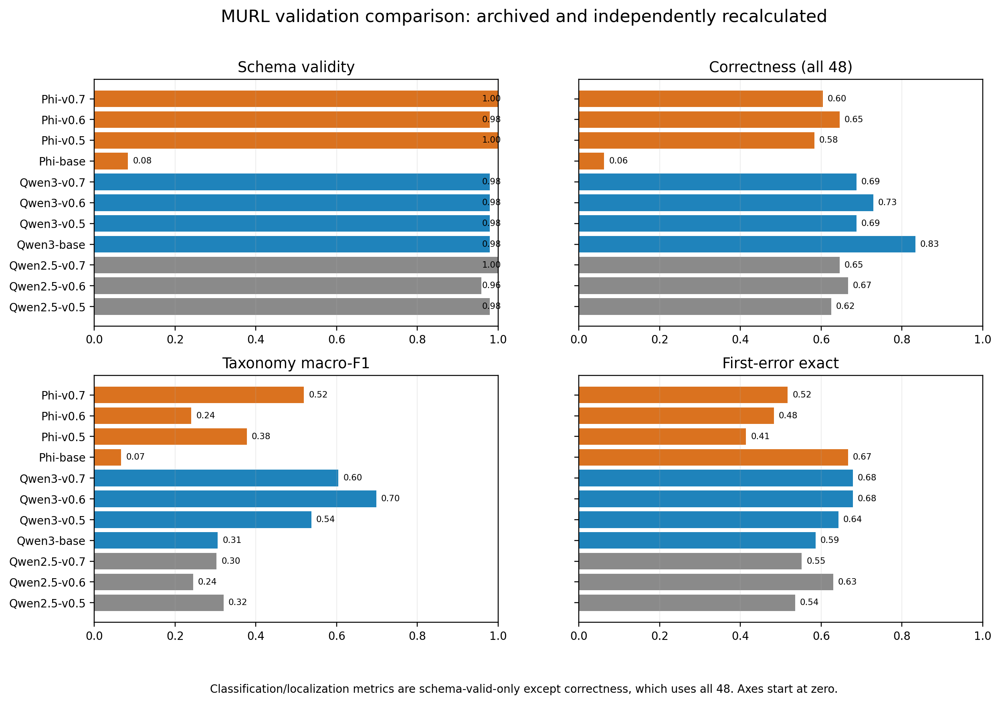
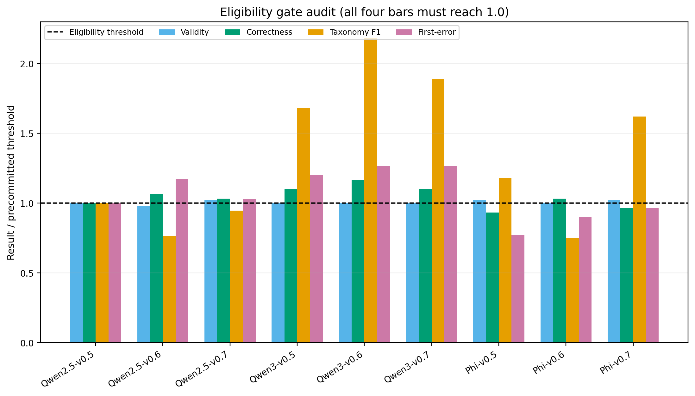
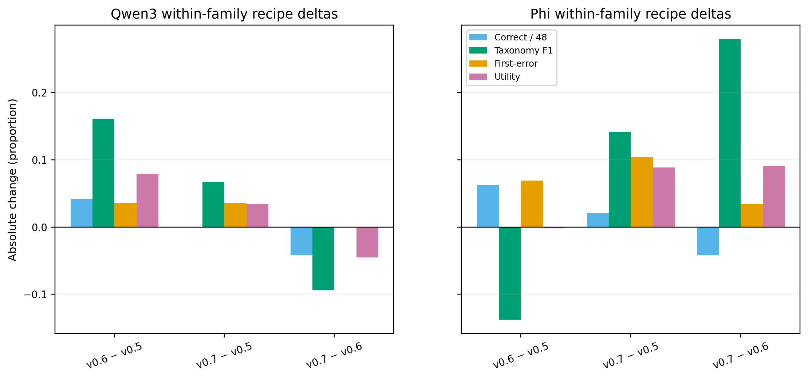
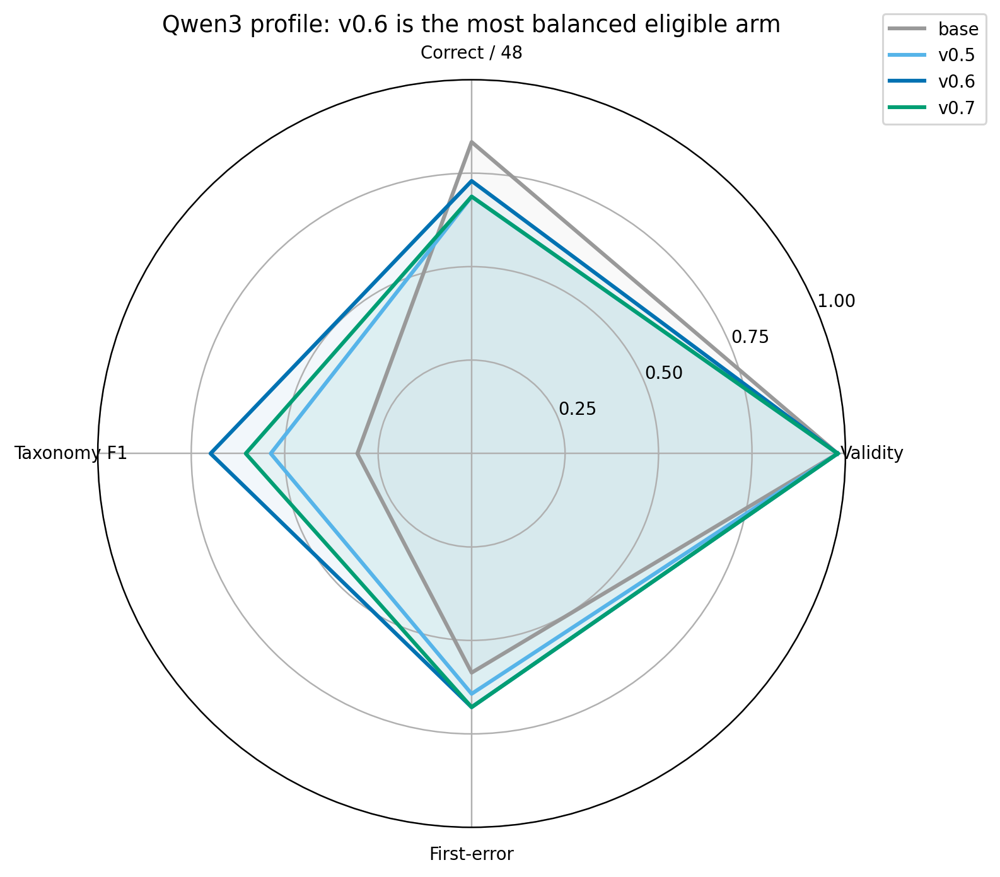
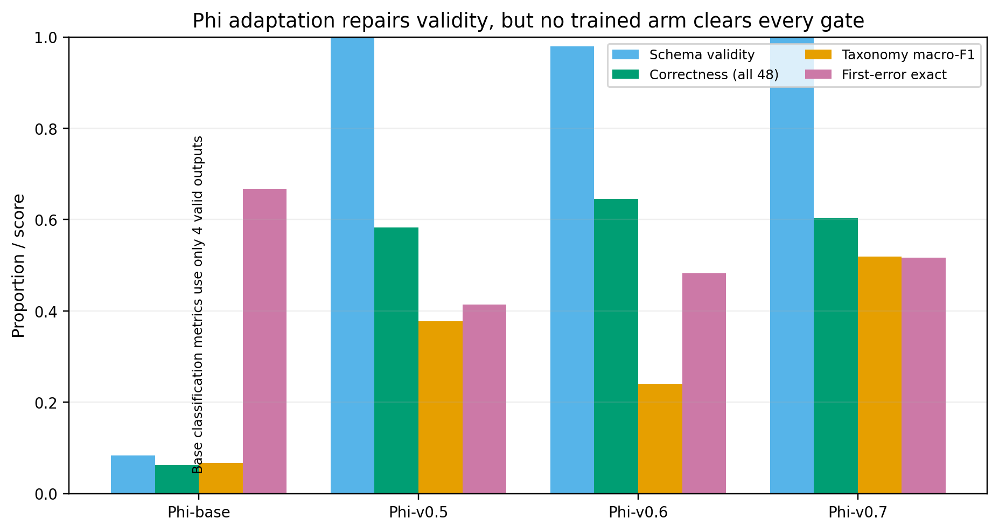
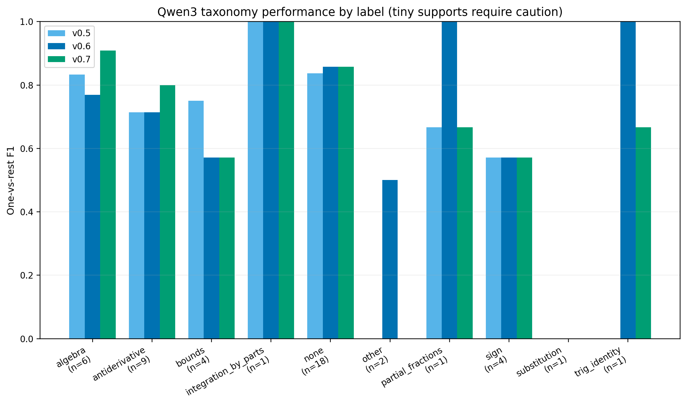
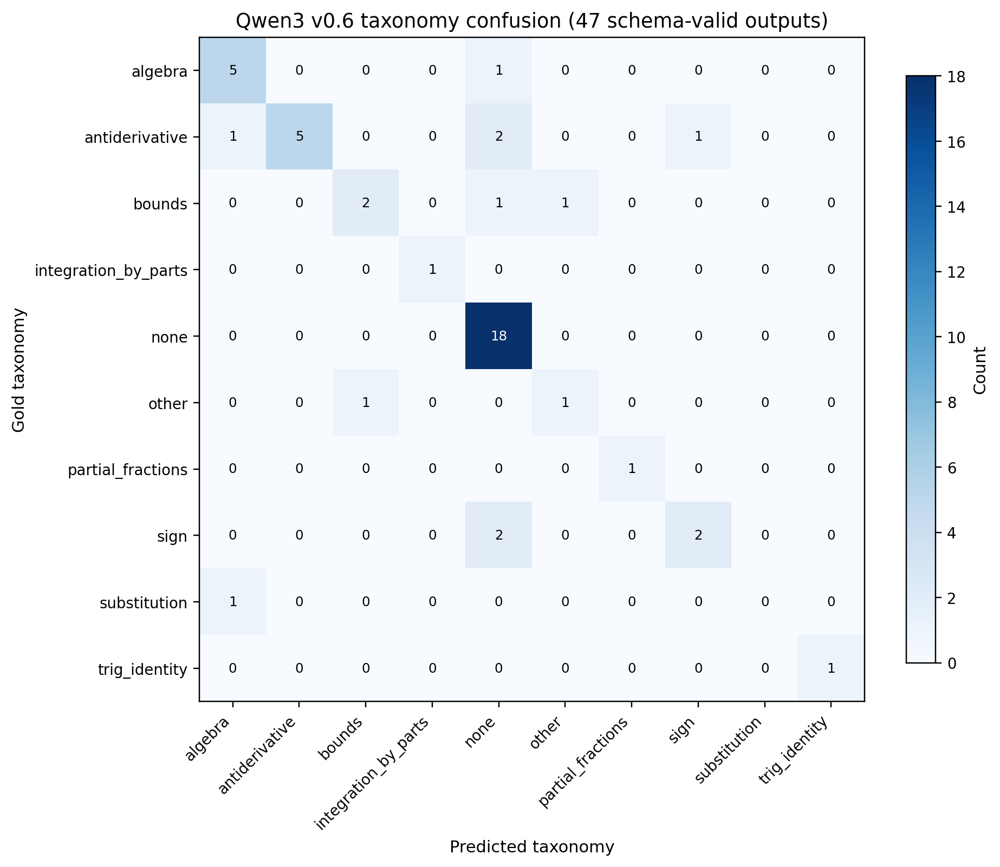
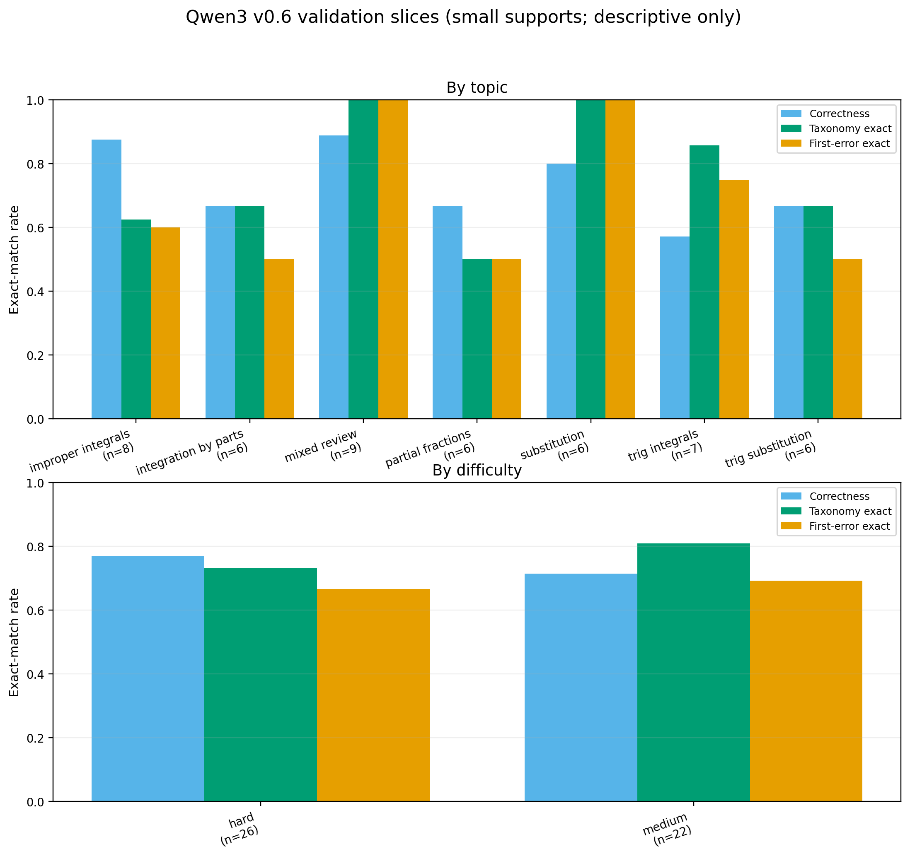

# MURL v0.8 final cross-family validation report

**Version:** 1.0 (2026-11-03)  
**Decision:** select **Qwen3-4B v0.6 hierarchical multi-task** for one frozen held-out test evaluation, subject to separate authorization. The held-out test was not opened, tokenized, inspected, or evaluated during this audit.

## Research question and audit scope

This experiment asks whether a frozen parameter-efficient grading recipe transfers across small instruction-model families, and which eligible family/recipe pair best balances overall correctness, error taxonomy, and first-error localization. This final audit starts from the local archives rather than earlier prose summaries.

The audit:

- CRC-tested all 54 ZIPs in `runs/baseline/` with `unzip -tq` and calculated SHA-256 for every ZIP;
- independently recalculated 11 validation aggregates from archived `gold.jsonl` and `outputs.jsonl` (eight v0.8 Qwen3/Phi arms plus three historical Qwen2.5 anchors);
- reconciled run IDs, pinned model revisions, prompts, dataset hashes, configs, software versions, raw outputs, evaluator results, adapters, tokenizers, checkpoints, and trainer state;
- inspected the six successful v0.8 executed notebooks and the Gemma, Ministral, Llama, and initial Phi setup-failure notebooks; and
- did not semantically open any test archive or the held-out split.

The complete machine-readable audit is in [`reports/v0.8-final/`](v0.8-final/), and the reproducibility entry point is [`scripts/v08_reproducibility.py`](../scripts/v08_reproducibility.py).

## Frozen protocol

All successful Qwen3 and Phi training arms used the training-only `data/training/v0.5-sft-train.jsonl` artifact (293 sampled conversations; SHA-256 `ea78f215770cf29880532e19126a9c27a28308bb1403c52152c7c995c1139826`) generated from the 155-example training split. Validation was the fixed 48-example split (SHA-256 `247a41683c61d80acbb4974c845a3f3f03fac2218f62f6da26ab3a091cb406ee`). The system prompt was `prompts/v0.2-sft-system.md` (SHA-256 `bba7ac0e231d661b7578dab544cc6611f65382889ac8632c9efcd086f37ed2b6`).

Common training settings were seed 20261004, NF4 4-bit loading with FP16 compute, QLoRA rank 8 / alpha 16 / dropout 0.05, learning rate 0.0002, warmup 3, effective batch size 8, a 2,048-token cap, and exactly 60 optimizer steps. Validation used greedy decoding, at most 256 new tokens, one output per example, no retries, and no repair. Runs executed on a 16 GB Tesla T4 with Torch 2.11.0+cu130 and Transformers 5.20.1; validation metadata also records Accelerate 1.15.0, bitsandbytes 0.50.2, and PEFT 0.21.2.

The arms were:

- **v0.5:** ordinary assistant-only SFT for 60 steps.
- **v0.6:** correctness-weighted decision phase for steps 1–30 (4:1:1), then diagnosis-weighted phase for steps 31–60 (1:4:4 for correctness:first-error:taxonomy).
- **v0.7:** 30 ordinary steps, checkpoint reload with optimizer/scheduler state, then 30 steps with first-error and taxonomy tokens weighted 2×.

Model pins and architecture mappings were:

| Family | Revision | QLoRA targets | Trainable parameters |
| --- | --- | --- | ---: |
| Qwen3-4B | `Qwen/Qwen3-4B@1cfa9a7208912126459214e8b04321603b3df60c` | `q_proj`, `k_proj`, `v_proj`, `o_proj`, `gate_proj`, `up_proj`, `down_proj`; native chat template with thinking disabled | 16,515,072 |
| Phi-4-mini-instruct | `microsoft/Phi-4-mini-instruct@cfbefacb99257ffa30c83adab238a50856ac3083` | fused `qkv_proj`, `o_proj`, fused `gate_up_proj`, `down_proj` | 11,534,336 |

## Recalculated results and eligibility

Eligibility required at least 47/48 schema-valid outputs, at least 30/48 correct over **all** validation examples, taxonomy macro-F1 at least 0.3201, and first-error exact match at least 0.536. The two decimal-reported floors are applied at their precommitted reporting precision (four decimals for taxonomy and three for first-error); this keeps the anchor-derived Qwen2.5 v0.5 arm inclusive even though its unrounded values are 0.320087… and 15/28 = 0.535714…. The same rounding rule is applied to every arm.

Utility is calculated only for selection among eligible arms:

```text
(correct over all 48 / 48 + taxonomy macro-F1 valid-only
 + first-error exact valid-only) / 3
```

| Family / arm | Valid | Correct all 48 | Correct valid-only | Taxonomy macro-F1 | First-error exact | MAD | Utility | Eligible |
| --- | ---: | ---: | ---: | ---: | ---: | ---: | ---: | :---: |
| Qwen2.5 v0.5 | 47/48 | 30/48 | 30/47 | 0.3201 | 15/28 (0.5357) | 0.3636 | 0.4936 | Yes* |
| Qwen2.5 v0.6 | 46/48 | 32/48 | 32/46 | 0.2449 | 17/27 (0.6296) | 0.3333 | 0.5137 | No |
| Qwen2.5 v0.7 | 48/48 | 31/48 | 31/48 | 0.3029 | 16/29 (0.5517) | 0.3478 | 0.5002 | No |
| Qwen3 base | 47/48 | 40/48 | 40/47 | 0.3057 | 17/29 (0.5862) | 0.4074 | 0.5751 | No |
| Qwen3 v0.5 | 47/48 | 33/48 | 33/47 | 0.5373 | 18/28 (0.6429) | 0.1429 | 0.6225 | Yes |
| **Qwen3 v0.6** | **47/48** | **35/48** | **35/47** | **0.6984** | **19/28 (0.6786)** | **0.1364** | **0.7020** | **Yes** |
| Qwen3 v0.7 | 47/48 | 33/48 | 33/47 | 0.6042 | 19/28 (0.6786) | 0.1364 | 0.6568 | Yes |
| Phi base | 4/48 | 3/48 | 3/4 | 0.0667 | 2/3 (0.6667) | 0.3333 | 0.2653 | No |
| Phi v0.5 | 48/48 | 28/48 | 28/48 | 0.3776 | 12/29 (0.4138) | 0.5000 | 0.4582 | No |
| Phi v0.6 | 47/48 | 31/48 | 31/47 | 0.2401 | 14/29 (0.4828) | 0.4783 | 0.4562 | No |
| Phi v0.7 | 48/48 | 29/48 | 29/48 | 0.5190 | 15/29 (0.5172) | 0.3636 | 0.5468 | No |

\* Eligible at the explicitly recorded threshold precision; see the preceding paragraph.

The independent evaluator reproduced every archived aggregate to within 1e-12. Qwen2.5 nominates v0.5 (the only eligible historical arm), Qwen3 nominates v0.6 (the eligible arm with highest utility), and Phi has no nominee. Qwen3 v0.6 has the highest family-nominee utility, so no tiebreak is needed.





## Within-family recipe effects

| Family | Contrast | Δ valid | Δ correct /48 | Δ taxonomy F1 | Δ first-error | Δ MAD | Δ utility |
| --- | --- | ---: | ---: | ---: | ---: | ---: | ---: |
| Qwen3 | v0.6 − v0.5 | 0 | +2 | +0.1611 | +0.0357 | −0.0065 | +0.0795 |
| Qwen3 | v0.7 − v0.5 | 0 | 0 | +0.0670 | +0.0357 | −0.0065 | +0.0342 |
| Qwen3 | v0.7 − v0.6 | 0 | −2 | −0.0941 | 0 | 0 | −0.0453 |
| Phi | v0.6 − v0.5 | −1 | +3 | −0.1376 | +0.0690 | −0.0217 | −0.0020 |
| Phi | v0.7 − v0.5 | 0 | +1 | +0.1414 | +0.1034 | −0.1364 | +0.0885 |
| Phi | v0.7 − v0.6 | +1 | −2 | +0.2789 | +0.0345 | −0.1146 | +0.0906 |

Qwen3 v0.6 is the clearest balanced gain: it adds two all-48 correctness decisions and 0.161 taxonomy F1 over v0.5 while slightly improving localization. Qwen3 v0.7 improves diagnosis over v0.5 but gives back two correctness decisions and 0.094 taxonomy F1 relative to v0.6. Phi demonstrates a real adaptation effect—validity rises from 4/48 at base to 47–48/48—but its recipe tradeoffs remain sharp. Phi v0.6 clears correctness but fails taxonomy and localization; v0.7 is its best balanced arm but misses correctness by one example and first-error exact by roughly 1.9 percentage points.







## Winner error and slice analysis

Qwen3 v0.6's taxonomy macro-F1 is 0.6984. One-vs-rest label F1 is strong for `integration_by_parts` and `trig_identity` (1.00 each), `partial_fractions` (1.00), `none` (0.857), `algebra` (0.769), and `antiderivative` (0.714). It is weaker for `bounds` and `sign` (0.571 each), `other` (0.500), and `substitution` (0.0). These values are not equally reliable: validation supports are 18 for `none`, 9 for `antiderivative`, 6 for `algebra`, 4 each for `bounds` and `sign`, 2 for `other`, and only 1 each for four labels.

The principal nonzero confusions are: antiderivative→none (2), sign→none (2), and one each for algebra→none, antiderivative→algebra, antiderivative→sign, bounds→none, bounds→other, other→bounds, and substitution→algebra. The model is perfect on the 18 valid gold-`none` cases. The apparent perfect scores on one-example labels must not be generalized.





By topic, valid-only correctness ranges from 4/7 for trig integrals to 7/8 for improper integrals and 8/9 for mixed review. Taxonomy exact is lowest for partial fractions (3/6) and reaches 9/9 for mixed review and 5/5 valid substitution examples. First-error exact is 3/5 for improper integrals, 2/4 for integration by parts, partial fractions, and trig substitution, 3/4 for trig integrals, and perfect on mixed review (5/5) and valid substitution errors (2/2). By difficulty, hard examples are 20/26 correct, 19/26 taxonomy exact, and 10/15 first-error exact; medium valid examples are 15/21 correct, 17/21 taxonomy exact, and 9/13 first-error exact. These are descriptive slices, not powered subgroup comparisons.



## Artifact and execution audit

Every v0.8 validation ZIP contains archived gold, raw outputs, prompt, run metadata, aggregate metrics, and per-example results. Every successful training ZIP contains resolved config, dataset metadata, training metrics, final adapter weights/config, tokenizer, checkpoint trainer state, optimizer/scheduler state, and source snapshot. The v0.7 bundles contain both stage-1 and final checkpoints. Saved metadata says adapter reload was verified.

Training runtimes were Qwen3 v0.5 1,389.841 s, v0.6 1,190.544 s, v0.7 stage metrics totaling the archived two-stage execution; Phi v0.5 864.476 s, v0.6 868.768 s, and v0.7 stage metrics totaling its archived two-stage execution. The `training-artifact-audit.csv` table reports the archived top-level runtime fields; v0.7's top-level `train_runtime` is the continuation stage and should not be misread as total wall-clock training.

Key v0.8 artifact hashes are below; all passed ZIP CRC verification. The complete 54-ZIP manifest, including historical bundles, sizes, member counts, and hashes, is [`archive-manifest.csv`](v0.8-final/archive-manifest.csv).

| Artifact | SHA-256 |
| --- | --- |
| `murl-v08-qwen3-phi-source.zip` | `21660cf96636ac121b99581b1e8fa1fdfdfa8fc01a43ca8c8486fc28fe9c4060` |
| `murl-v08-v06-cross-family-source.zip` | `f4d6e82d14b9fad9465263ac3528d50aa0968c0c4e6e033c210ce549816615c1` |
| `murl-v08-v07-cross-family-source.zip` | `7bf5c4d6855acf93c5694b0438b0e82e8e3fd32fa772b27b2ed235c459719d9a` |
| `qwen3-4b-v08-base-control-validation-results.zip` | `47409c394eb17f5e39f2f3ee264dc2346fc79e7badf1c30d014e442933145feb` |
| `qwen3-4b-v08-v05-training-results.zip` | `5ab23ec2b051b4df599b395d81f9049e0f9d196e246beb4021e6d8a7efddd7a6` |
| `qwen3-4b-v08-v05-validation-results.zip` | `0a7d39d3f72a2a13a86c2df2b7f2e228d15d9171532ded21b154fc1633ca323b` |
| `qwen3-4b-v08-v06-training-results.zip` | `35ac9d8293df2ddc85c051fca14eb8da7e59540b3ce6277972839cb13c190610` |
| `qwen3-4b-v08-v06-validation-results.zip` | `e491eda904a7504f8c8fb6ccb9011be947a325e2072c9c5e9bfeecffc284420c` |
| `qwen3-4b-v08-v07-training-results.zip` | `859b634f454a9ed08ea805529bbc01bb4b53d22bf7dff02eca1055aacae3b72b` |
| `qwen3-4b-v08-v07-validation-results.zip` | `dcaf24b9fcbbf943cca2c3fbae3f879ac43e9d8b2121817712b2807933571c03` |
| `phi4-mini-v08-base-control-validation-results.zip` | `8398a4e276457a0e7d34d7e1ae98b57b512e0ecda027ec68296463599a6ef898` |
| `phi4-mini-v08-v05-training-results.zip` | `77413debbd281b025645a3efd15113436a9ef072e8d530e0837b5e213ea019a3` |
| `phi4-mini-v08-v05-validation-results.zip` | `d292432f50071ae79ae8fe27fffba8c9d8d585b106ee9b770861de0e2b518923` |
| `phi4-mini-v08-v06-training-results.zip` | `55de13ea6b03e3014c35d8ac5cd776eb5c9091d3efc98e1c74766bf6d39b6229` |
| `phi4-mini-v08-v06-validation-results.zip` | `5e1e6e52ca901e98557f6c3432ed7f6d06618fe15aff162f3ece322f9db8690b` |
| `phi4-mini-v08-v07-training-results.zip` | `99318f3aa66f1e26be5099c812ca1e91f025c95025897fe38fe6bac309e23395` |
| `phi4-mini-v08-v07-validation-results.zip` | `d87c339907c57029b05cc9ee19cbaf08fc18873223ff4c29d95e3e60c5883c47` |

Executed-notebook hashes match the execution plan: Qwen3 v0.5 `87c86c…`, v0.6 `5ed717…`, v0.7 `a9e78e…`; Phi v0.5 `381573…`, v0.6 `dfa99c…`, v0.7 `2de99e…`. Full hashes can be regenerated with `shasum -a 256 runs/baseline/*.ipynb`.

## Infeasible and unscored attempts

- **Gemma 4 E4B:** base-only. The executed notebook records setup repairs for `Gemma4ClippableLinear` targeting, freeze-only preparation, and external loss computation. The frozen 2,048-token v0.5 recipe still failed on its first training step on a 16 GB T4, approximately 712 MB beyond capacity. The recipe was not shortened or otherwise altered. Setup errors and the final OOM are not scored results.
- **Ministral 3 3B:** the complete pinned checkpoint downloaded and its safetensors were verified, but loading rejected the frozen NF4 `BitsAndBytesConfig` because the checkpoint embeds `FineGrainedFP8Config`. Switching quantization would have violated the comparison. No base inference, adapter attachment, training, or validation score occurred. Notebook SHA-256 is `455e5bea9a84c5d6a8b41fcf3eb03af5e84722c1e5b82ab6605987bf7a4918f5`.
- **Llama 3.2 3B:** the staged attempt failed before inference with a Hugging Face `401 GatedRepoError` at pinned revision `0cb88a4f764b7a12671c53f0838cd831a0843b95`. It is access-infeasible and unscored.
- **Initial Phi attempt:** ended during model fetching and has no validation output or run directory. It remains setup history only.
- **SmolLM3:** explicitly out of scope and not run.

## Limits of inference

The validation set has only 48 examples. A single correctness decision changes accuracy by 2.08 percentage points, and one localization decision changes first-error exact by about 3.45–3.57 points. Four taxonomy labels have support one in the winner's valid outputs, so their per-label F1 can jump from zero to one based on one prediction. Recipe differences are paired on a common validation set, which improves descriptive comparability, but no confidence interval or significance test can make these sparse label estimates stable. The results support the frozen selection rule and a one-time test, not claims of broad superiority across integration-grading populations.

## Exact one-time held-out test plan (not executed)

If separately authorized, perform exactly one test evaluation as follows:

1. Use `qwen3-4b-v08-v06-training-results.zip` SHA-256 `35ac9d8293df2ddc85c051fca14eb8da7e59540b3ce6277972839cb13c190610`; extract only its final `models/qwen3-4b-murl-v0.8-v0.6/adapter/` and tokenizer artifacts.
2. Load `Qwen/Qwen3-4B` revision `1cfa9a7208912126459214e8b04321603b3df60c` in NF4 with FP16 compute and `enable_thinking: false`; verify the adapter reload and archived config hashes before test access.
3. Use the frozen `prompts/v0.2-sft-system.md` hash `bba7ac0e231d661b7578dab544cc6611f65382889ac8632c9efcd086f37ed2b6`, native chat template, greedy decoding, `do_sample=false`, and `max_new_tokens=256`.
4. Only after all preceding checks pass, read the frozen 47-example held-out test split once, generate one output per example with no retries or repair, and archive raw outputs before scoring.
5. Run the unchanged repository evaluator once; report validity and all classification/localization metrics with denominators. Save metadata, gold hash, raw outputs, per-example results, aggregate, source snapshot, and executed notebook; CRC-test and hash the final ZIP.
6. Do not use the test result to tune a prompt, recipe, adapter, threshold, or replacement model. Any later work begins a separately versioned study with a new untouched test set.

This plan names one frozen winner and does not itself authorize test access.

## Reproduction

From the repository root:

```bash
python3 scripts/v08_reproducibility.py
python3 -m unittest discover -s evaluation/tests -v
```

The first command requires Python 3.10+, NumPy, and Matplotlib. It calculates all ZIP hashes, performs in-process CRC checks, audits required archive members, independently re-evaluates the saved validation outputs, rewrites every CSV/JSON table, regenerates all PNG/SVG figures, and refreshes a static notebook render. The notebook [`notebooks/v0.8-final-reproducibility.ipynb`](../notebooks/v0.8-final-reproducibility.ipynb) provides the same workflow with an explicitly disabled held-out cell. The general benchmark validator is intentionally omitted here because its interface reads all splits, including the still-frozen held-out test.
