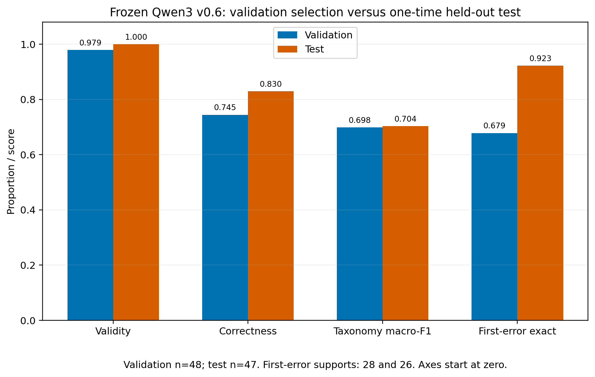
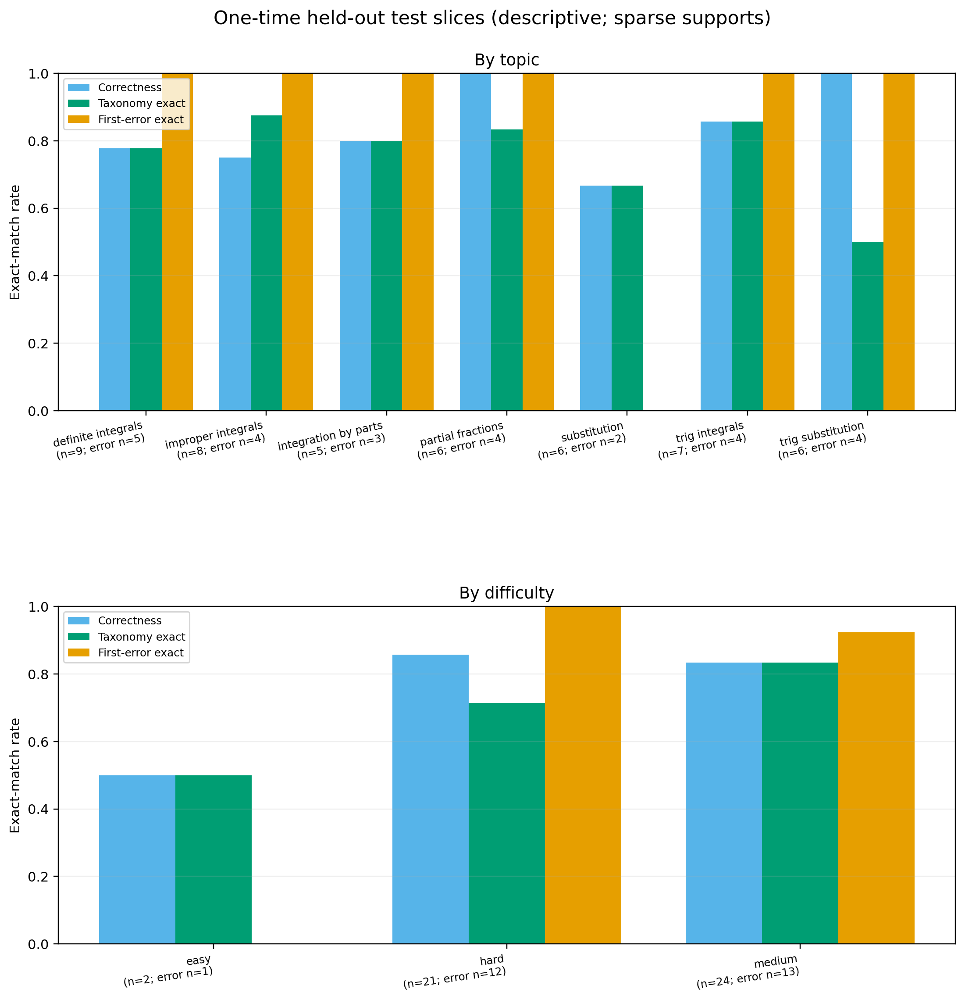
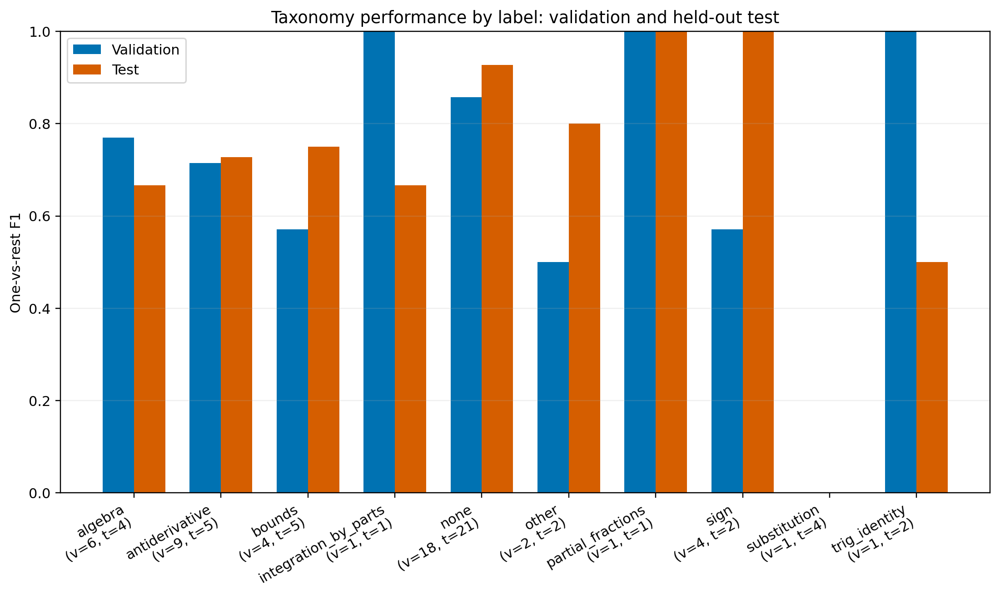
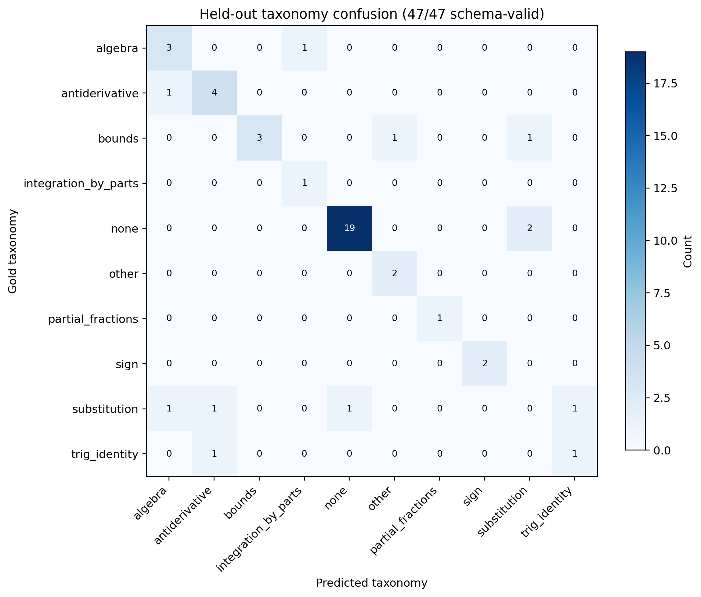
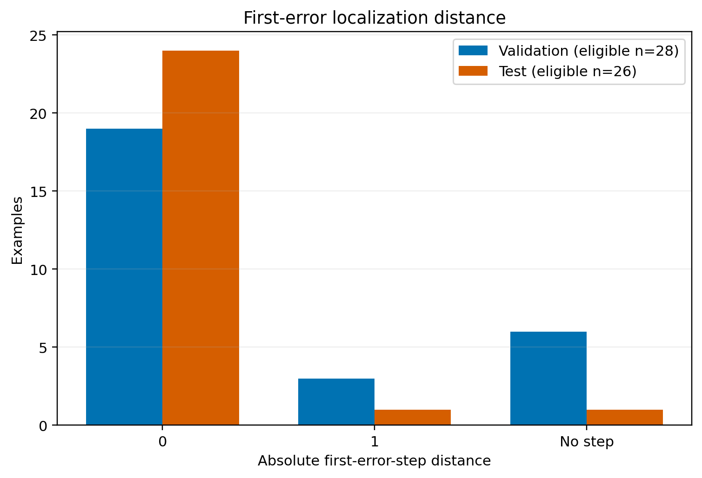

# MURL v0.8 one-time held-out test report

## Result

The precommitted one-time held-out evaluation of the selected **Qwen3-4B v0.6 hierarchical multi-task** adapter is complete. The frozen model produced a schema-valid output for all 47 test examples and matched the overall-correctness label on 39/47 (0.8298). Correctness macro-F1 was 0.8445, taxonomy macro-F1 was 0.7037, and first-error localization was exact on 24/26 eligible examples (0.9231). Mean absolute first-error distance was 0.04 over the 25 eligible examples with an integer predicted step; one eligible example had no predicted step.

This is a final estimate for the already-selected system, not another selection round. No model, prompt, template, decoding, or evaluator choice was changed in response to test performance.



## Frozen selection on validation

The independent v0.8 audit recalculated 11 validation archives, audited 6 training archives, and hashed 54 ZIP archives. Under the frozen eligibility and utility rule, it selected `qwen3-v0.6`, whose complete arm ID is `qwen3-4b-murl-v0.8-v0.6`. Selection used validation only:

| Validation measure | Frozen winner result |
|---|---:|
| Examples | 48 |
| Schema-valid | 47/48 (0.9792) |
| Overall correctness | 35/47 valid (0.7447); 35/48 all examples (0.7292) |
| Correctness macro-F1 | 0.6341 |
| Taxonomy macro-F1 | 0.6984 |
| First-error exact | 19/28 eligible (0.6786) |
| First-error mean absolute distance | 0.1364 |
| Frozen selection utility | 0.7020 |

The selection evidence and rule remain documented in the [v0.8 cross-family report](v0.8-final-cross-family-report.md), [decision record](v0.8-final/decision.json), and [selection reproducibility notebook](../notebooks/v0.8-final-reproducibility.ipynb).

## One-time held-out execution

Run ID: `qwen3-4b-murl-v0.8-v0.6-final-test-20261103`.

The preflight verified the selected training archive, adapter members, source snapshot, exact base revision, validation archive, prompt, native Qwen3 chat template, tokenizer configuration, resolved training configuration, evaluator, split manifest, and dataset provenance against the audited inputs. The held-out split was checked only for its SHA-256 and 47-line count before the authorized run. The run then used:

- `Qwen/Qwen3-4B` at revision `1cfa9a7208912126459214e8b04321603b3df60c`;
- the archived v0.6 adapter and tokenizer;
- the fixed v0.2 SFT system prompt;
- Qwen3's native chat template with `enable_thinking: false`;
- 4-bit NF4 loading with float16 compute;
- greedy decoding (`do_sample: false`), at most 256 new tokens;
- exactly one output for each of 47 examples, with no retry, repair, or manual edit;
- the existing evaluator, invoked exactly once after the raw outputs had been archived.

Hardware was a Google Colab Tesla T4. Recorded software was Python's Colab runtime with PyTorch `2.11.0+cu130`, Transformers `5.20.1`, Accelerate `1.15.0`, bitsandbytes `0.50.2`, and PEFT `0.21.2`.

### Setup incident and execution count

The first setup invocation created the immutable run directory and copied the authorized gold file, then stopped on `ModuleNotFoundError: scripts` before tokenization, generation, or any model output. It generated **0 outputs**. The strict continuation used that same immutable directory and frozen gold copy, recorded the failure in `metadata.json`, and did not reread the original test file. It then performed exactly **one generation pass** producing 47/47 outputs. Raw outputs were ZIP-archived before the evaluator was invoked exactly **once**. The final manifest records `generation_passes: 1` and `scoring_invocations: 1`.

## Held-out metrics

All classification and localization metrics follow the precommitted valid-only evaluator convention. Because every test output was valid, the valid-only correctness denominator and the all-example denominator are both 47.

| Test measure | Result |
|---|---:|
| Examples / outputs | 47 / 47 |
| Schema-valid | 47/47 (1.0000) |
| Overall correctness accuracy | 39/47 (0.8298) |
| Correctness macro-F1 | 0.8445 |
| Taxonomy exact match | 36/47 (0.7660) |
| Taxonomy macro-F1 | 0.7037 |
| First-error eligible | 26 |
| First-error exact | 24/26 (0.9231) |
| First-error mean absolute distance | 0.04 over 25 integer predictions |
| Missing / unexpected / duplicate IDs | 0 / 0 / 0 |

The correctness confusion counts were: 18 correct→correct, 14 incorrect→incorrect, 6 minor-error→minor-error, and 1 insufficient-work→insufficient-work. The eight mistakes comprised four incorrect→minor-error cases and one each of minor-error→correct, correct→incorrect, correct→minor-error, and minor-error→incorrect.

## Topic, difficulty, and label analysis



Topic correctness ranged from 4/6 for substitution to 6/6 for both partial fractions and trigonometric substitution. First-error localization was exact for every eligible topic example except substitution (0/2). Taxonomy exact match was weakest for trigonometric substitution (3/6) and strongest for improper integrals (7/8); supports are too small for stable topic rankings.

By difficulty, correctness was 1/2 easy, 18/21 hard, and 20/24 medium. Taxonomy exact match was 1/2, 15/21, and 20/24, respectively. First-error exact match was 0/1 easy, 12/12 hard, and 12/13 medium. The two-example easy slice should not be interpreted as a reliable difficulty trend.



Test one-vs-rest taxonomy F1 was 1.00 for partial fractions (support 1) and sign (support 2); 0.9268 for none (21); 0.80 for other (2); 0.75 for bounds (5); 0.7273 for antiderivative (5); 0.6667 for algebra (4) and integration by parts (1); 0.50 for trigonometric identity (2); and 0 for substitution (4). These values are descriptive: eight of ten non-`none` supports are five or fewer, and several apparent changes from validation are a single example.



The largest taxonomy error pattern was failure to recognize substitution: the four gold substitution examples were predicted once each as algebra, antiderivative, none, and trigonometric identity. Two gold `none` examples were predicted as substitution. All other off-diagonal cells had count one or zero.



## Validation comparison and caveats

Test validity rose from 47/48 to 47/47, valid-only correctness accuracy from 0.7447 to 0.8298, correctness macro-F1 from 0.6341 to 0.8445, taxonomy macro-F1 from 0.6984 to 0.7037, and first-error exact match from 0.6786 to 0.9231. These are descriptive validation-to-test differences, not evidence of improvement: the splits contain different examples, test has only 47 records, and label and slice supports are sparse. No confidence claim, post-test tuning, or model reselection is warranted from these differences.

## Artifacts and hashes

The authoritative run artifacts are intentionally ignored by Git and stored locally under `runs/final/`. The report tables, figures, archive manifest, and archive-only reproduction code are versioned.

| Artifact | SHA-256 |
|---|---|
| Final run ZIP | `a14ef576c8becd41de3f38ffd9edc7a9adfc6b267679cfa21e28e97a757c2d9c` |
| Raw pre-score outputs ZIP | `4d955c8a94b5031736a1647d7b16bf837e2589b6c4322a835d245b2ca2e14928` |
| Executed Colab CLI notebook/log | `8a42c363415865df1be098b6bad0c769782327899907c9f4005a456e68c60f73` |
| Selected training archive | `35ac9d8293df2ddc85c051fca14eb8da7e59540b3ce6277972839cb13c190610` |
| Selected validation archive | `e491eda904a7504f8c8fb6ccb9011be947a325e2072c9c5e9bfeecffc284420c` |
| Immutable source snapshot | `f4d6e82d14b9fad9465263ac3528d50aa0968c0c4e6e033c210ce549816615c1` |
| Adapter weights | `1f104dd6349576669c66f7e7b0e6b8d4e5f7f70f6b42e60b527029b8da49961c` |
| Held-out test split | `b3f61a20f95c2050a9bf8d8ef01cc3ff5d56c9996888d404a83d351f563bdf59` |
| Prompt | `bba7ac0e231d661b7578dab544cc6611f65382889ac8632c9efcd086f37ed2b6` |
| Evaluator | `e3b84c6953297af9e7a8d46c5c15616c282dd6908d2488a31488072a644cbd6c` |
| Resolved configuration | `ec59b1e44176e4b96eb2afd491fbb489dd66725c19e84068c65c4b686a2c68d7` |
| Tokenizer configuration | `c4f4c62b741ab2940841480f9942f378d7d3878d47c2babb862af7381c59b952` |
| Native chat template | `a55ee1b1660128b7098723e0abcd92caa0788061051c62d51cbe87d9cf1974d8` |

The complete frozen-input map, including adapter config, split manifest, raw dataset, and preparation script hashes, is in [artifact-manifest.json](v0.8-final-test/artifact-manifest.json). Both the final and raw ZIPs passed `unzip -tq` with no errors.

## Reproduce from archived outputs only

The [final-test companion notebook](../notebooks/v0.8-final-test-reproducibility.ipynb) and [archive-only helper](../scripts/v08_final_test_artifacts.py) verify the fixed artifact hashes and the one-generation/one-scoring manifest, then regenerate every CSV and PNG/SVG figure from archived evaluator outputs. They do not load the model, run generation, or invoke the evaluator.

```bash
shasum -a 256 runs/final/qwen3-4b-murl-v0.8-v0.6-final-test-20261103.zip \
  runs/final/qwen3-4b-murl-v0.8-v0.6-final-test-20261103-raw-pre-score.zip \
  runs/final/qwen3-4b-murl-v0.8-v0.6-final-test-20261103-executed.ipynb
unzip -tq runs/final/qwen3-4b-murl-v0.8-v0.6-final-test-20261103.zip
unzip -tq runs/final/qwen3-4b-murl-v0.8-v0.6-final-test-20261103-raw-pre-score.zip
python3 scripts/v08_final_test_artifacts.py
```

This reproduction path is deliberately post hoc and archive-only. The held-out test generation was run exactly once.
